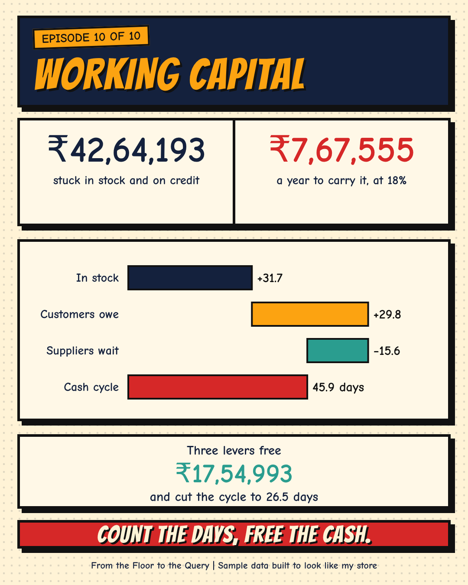

[← Back to all episodes](../README.md)

# Episode 10: Working capital cycle (Python + Excel)



*From the Floor to the Query. Real business problems. Real code. One analyst who's seen both sides.*

## The problem
Profit is what is left after costs. Cash is what is in the bank. A store can show a profit and still run short, because money sits in stock on the shelf and in bills customers have not paid yet, while suppliers want theirs. The **cash conversion cycle** counts those days.

## The question
How many days does a rupee stay stuck between paying a supplier and being paid by a customer, how much money is that, what does carrying it cost, and which levers free the most cash?

## The data (synthetic)
A sample dataset built to look like a building-materials store. 6 product categories, 3 customer types. Files:
- `data/sales.csv`: 2,855 sale lines (sale_id, sale_date, customer_type, category, revenue, cogs, paid_date); 2,519 fall in the window.
- `data/purchases.csv`: 336 supplier bills (bill_id, bill_date, category, amount, paid_date).
- `data/inventory_month_end.csv`: closing stock by category at each month-end.
- Window: 1 Oct 2025 to 30 Sep 2026. Flows start 1 Aug 2025 (a 2-month warm-up) so the October balances are not understated. Some `paid_date` values fall after 30 Sep 2026 (the latest payment date in the file is 26 Nov 2026), which is what receivables at year-end are.
- Revenue ₹3,49,68,904, COGS ₹3,19,39,529, gross profit ₹30,29,375 (8.7%). Separate dataset from earlier episodes.

**What the generator SET (plainly):**
- Stock days by category (cement 10, TMT bar 18, sand 5, paint 50, putty 42, tile 95), supplier payment days (10, 7, 3, 30, 30, 20), margins, and the share of revenue by category.
- Credit terms: contractors 30 days plus a delay (about 8 days on average, and 12% of the time 25 more); homeowners pay at the counter; small repair jobs 7 days plus about 2.
- Revenue split by customer type (72% / 24% / 4%) and a seasonal shape.
- The measured days below differ from the set days because balances are averaged over month-ends and stock is bought in lumps.
- The **18% a year cost of money is an assumption** (same as Episode 6). The three levers are what-ifs I chose. They are not forecasts.

No tuning after the first run. The seed (2026 + 10) was not searched for. Every row was audited (no duplicates, no blanks, no negative amounts, no payment before the sale or bill, cost always below revenue).

## Approach
1. **Month-end balances** (12 month-ends): inventory from the stock file; receivables = sales made on or before the date and not yet paid; payables = bills dated on or before the date and not yet paid.
2. **Days**, on annual flows: DIO = average inventory / COGS x 365; DSO = average receivables / revenue x 365; DPO = average payables / COGS x 365; cycle = DIO + DSO - DPO.
3. **Money stuck** = average inventory + average receivables - average payables. **Cost of carrying** = that x 18%.
4. **Levers:** cut stock days 30% on the three slow categories (paint, putty, tile); contractors pay 10 days faster; suppliers give 5 more days. Cash released and the yearly saving at 18%.
5. **Cross-check:** every headline number rebuilt in DuckDB SQL. **Excel model** with live formulas and a Checks sheet against the Python numbers.

## Results
| Measure | Value |
|---|---|
| DIO (days in stock) | 31.7 |
| DSO (days customers take to pay) | 29.8 |
| DPO (days the store takes to pay suppliers) | 15.6 |
| **Cash conversion cycle** | **45.9 days** |
| Average inventory | ₹27,73,863 |
| Average receivables | ₹28,56,252 |
| Average payables | ₹13,65,922 |
| **Working capital tied up** | **₹42,64,193** |
| Cost of carrying it (18% a year) | ₹7,67,555 (25.3% of gross profit) |

Stock side (sorted by average inventory):

| Category | Set stock days | Measured DIO | Average inventory | Share of stock | Set payable days | Measured DPO |
|---|---|---|---|---|---|---|
| Floor Tile 2x2 | 95 | 102.8 | ₹12,22,531 | 44.1% | 20 | 16.1 |
| Emulsion Paint | 50 | 52.0 | ₹6,09,483 | 22.0% | 30 | 31.4 |
| TMT Bar 12mm | 18 | 18.1 | ₹3,47,860 | 12.5% | 7 | 7.0 |
| Cement OPC 53 | 10 | 10.1 | ₹2,82,006 | 10.2% | 10 | 16.0 |
| Wall Putty | 42 | 41.8 | ₹2,59,638 | 9.4% | 30 | 27.9 |
| River Sand | 5 | 5.0 | ₹52,345 | 1.9% | 3 | 4.6 |

Credit side:

| Customer type | Revenue | Average receivables | DSO (days) |
|---|---|---|---|
| Contractor | ₹2,51,83,883 | ₹28,24,616 | 40.9 |
| Homeowner | ₹83,82,680 | ₹0 | 0.0 |
| Small repair | ₹14,02,341 | ₹31,635 | 8.2 |

What-if levers:

| Lever | Cash released | Yearly saving at 18% |
|---|---|---|
| Cut stock days 30% on paint, putty, tile | ₹6,27,496 | ₹1,12,949 |
| Contractors pay 10 days faster | ₹6,89,969 | ₹1,24,194 |
| Suppliers give 5 more days | ₹4,37,528 | ₹78,755 |
| Total cash released | ₹17,54,993 | ₹3,15,899 |

- Floor tile holds 44.1% of the stock at 102.8 days. Contractors owe 98.9% of all receivables, because homeowners pay at the counter.
- With all three levers the cash tied up falls from ₹42,64,193 to ₹25,09,200 and the cycle from 45.9 to 26.5 days.
- DSO is measured on total revenue (cash sales included), which is the usual convention. On contractor sales alone it is 40.9 days.
- Levers are not free. Less stock can mean stock-outs; faster collection can cost customers; longer supplier terms can come with a higher rate (Episode 9). None of those costs is in the model.

## Excel model
`excel/working_capital_model.xlsx` has 7 sheets: Notes, Inputs, Monthly, Categories, Customers, Summary, Checks. 195 formulas, all live; recalculated with LibreOffice with 0 errors.
- **Blue** cells are typed inputs, **black** are formulas, **green** are links to another sheet, **yellow** are key assumptions (cost of money and the three lever sizes on the Inputs sheet).
- Change the cost of money or a lever on Inputs and everything recalculates. Tested: at 12% cost of money and a 50% stock cut, the carrying cost and lever 1 recalculated to the expected values.
- The blue balances on Monthly, Categories and Customers are the Python results (`results/*.csv`). The Checks sheet compares the workbook's outputs with `results/summary.csv` (all OK) and tests that the sheets add up to each other.
- `excel/build_model.py` rebuilds the workbook from the results files.
- If Excel shows zeros, press F9 or open and save once: the file carries values calculated by LibreOffice.

## Files
- `generate_data.py`: builds the data (seeded).
- `data/`: `sales.csv`, `purchases.csv`, `inventory_month_end.csv`, `settings_generator.csv` (for checking only).
- `python/working_capital.py`: balances, days, levers.
- `crosscheck.py`: the same numbers in DuckDB SQL.
- `excel/`: `build_model.py`, `working_capital_model.xlsx`.
- `results/`: `monthly_balances.csv`, `by_category.csv`, `by_customer_type.csv`, `levers.csv`, `summary.csv`, `crosscheck_output.txt`.
- `cover.png`: the post image.

## How to run
```
pip install pandas numpy duckdb openpyxl
python generate_data.py
python python/working_capital.py
python crosscheck.py
python excel/build_model.py
```
Run from inside the `episode-10` folder. `build_model.py` writes formulas without values; open the file in Excel (it calculates on open) or recalculate in LibreOffice before reading values with a script. Cross-check result: all 16 headline numbers match the SQL rebuild.

## Limits
- Averages of 12 month-ends, not daily balances. Seasonal swings (June to August are slow) move the monthly days a lot.
- No bad debt, tax or GST, advances from customers, or returns. Episode 6 covers bad debt.
- The 18% cost of money, the lever sizes and the choice of "slow" categories are mine.
- Payables are on a COGS basis, and the stock file is built from purchases minus COGS, so the three balances are consistent with each other by construction.
- The set days and the measured days differ, as explained above. Real data would not come with the set days to check against.

## Level up
Age the receivables (0 to 30, 31 to 60, over 60 days) to see who is really late. Or add margin to the stock table and rank categories by gross profit per rupee of stock, so tile can be judged against cement.
