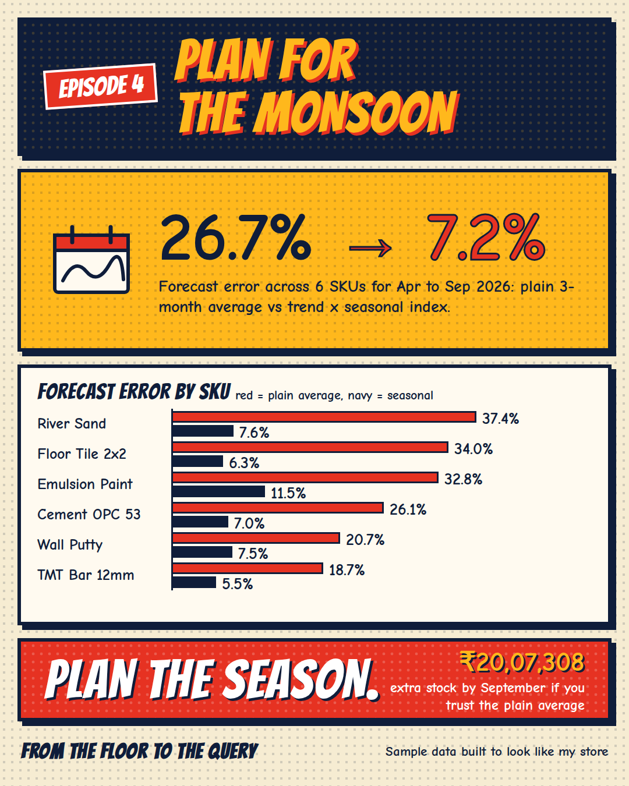
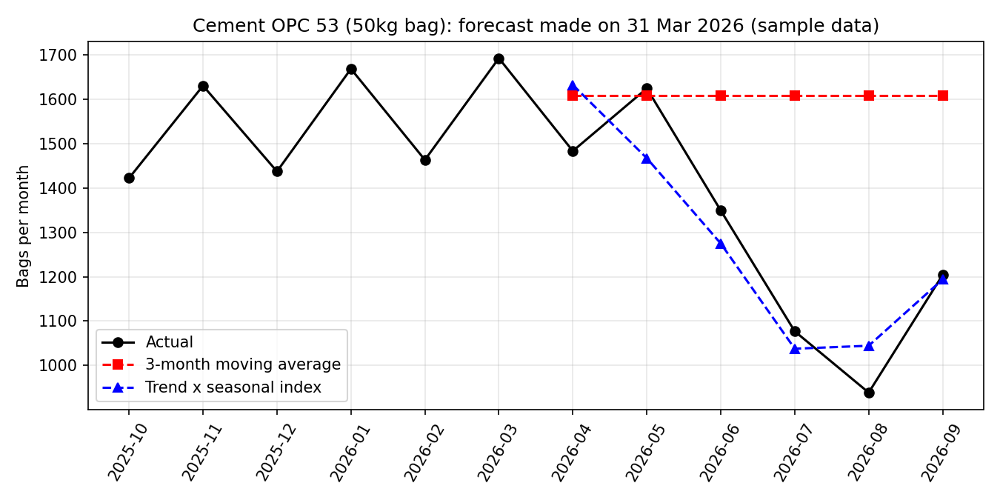

[← Back to all episodes](../README.md)

# Episode 4: Plan for the Monsoon
**Seasonal demand forecasting with Python (moving average vs trend x seasonal index)**



> All data here is synthetic: a sample dataset I built to look like a building-materials store. No real store records. The seasonal patterns were set by me when I built the data, so the result shows how the method behaves, not what a real store looks like.

## The problem
Demand is not flat. Cement, sand and paint rise and fall with the calendar. An average of the last few months carries the *current* season forward, so it over-orders just before demand drops.

## The question
If you forecast the next 6 months on 31 Mar 2026, how wrong is a plain moving average, and how much better does a seasonal method do?

## Approach
1. Data: monthly units for 6 SKUs, Oct 2023 to Sep 2026 (36 months). Train on Oct 2023 to Mar 2026, test on Apr to Sep 2026.
2. **Plain 3-month moving average first**: average of Jan to Mar 2026, held flat for the next 6 months.
3. **Same month last year**: copy Apr to Sep 2025. A simple seasonal baseline.
4. **Trend x seasonal index**: fit a straight-line trend, measure how far each calendar month sits above or below it, average those ratios per month (the index), then forecast trend x index.
5. Compare with WAPE (total absolute error / total actual demand), and value-weight across SKUs using cost price.

## Results (forecast made 31 Mar 2026, tested on Apr to Sep 2026)
| SKU | 3-month average | Same month last year | Trend x seasonal index |
|---|---|---|---|
| River Sand (per cft) | 37.4% | 11.2% | 7.6% |
| Floor Tile 2x2 (box) | 34.0% | 5.1% | 6.3% |
| Emulsion Paint (20L) | 32.8% | 14.3% | 11.5% |
| Cement OPC 53 (50kg bag) | 26.1% | 10.5% | 7.0% |
| Wall Putty (40kg) | 20.7% | 6.1% | 7.5% |
| TMT Bar 12mm (per kg) | 18.7% | 5.9% | 5.5% |
| **All 6 (value-weighted)** | **26.7%** | **9.3%** | **7.2%** |

- Plain 3-month average: 26.7% error, and every SKU ends September with extra stock. Net build-up across the 6 SKUs: **₹20,07,308** at cost.
- Trend x seasonal index: 7.2% error, net stock within ₹43,237 of real demand.
- Copying last year's month scores 9.3%. It is a strong baseline and beats trend x index on 2 of 6 SKUs (Floor Tile, Wall Putty). But it ignores growth, so it under-orders by ₹4,77,396 in net.
- Cement OPC 53: the average said 1,608 bags a month. July sold 1,077 and August 939.



## Files
- `generate_data.py`: seeded data generator (seed 2026)
- `data/monthly_demand.csv`, `data/skus.csv`
- `python/seasonal_forecast.py`: the three methods and the comparison
- `python/plot_forecast.py`: the cement chart
- `results/forecast_results.csv`, `results/test_forecasts.csv`, `results/cement_forecast.png`

## How to run
```
pip install pandas numpy matplotlib
python generate_data.py
python python/seasonal_forecast.py
python python/plot_forecast.py
```

## Limits
- Synthetic data with seasonality I put in. Real seasonality is noisier and shifts (Diwali moves between October and November).
- One train/test split and a 6-month horizon. A different cut-off would change the numbers.
- Only 30 training months, so each calendar month's index rests on 2 or 3 observations.
- Sales are not the same as demand: if you ran out of stock, real demand was higher than the sales you recorded.
- Linear trend only. Promotions, price changes and supplier delays are ignored.

## Level up
Try Holt-Winters (`statsmodels`), test across many cut-off dates (rolling-origin backtest), and turn forecast error into a safety-stock number.
