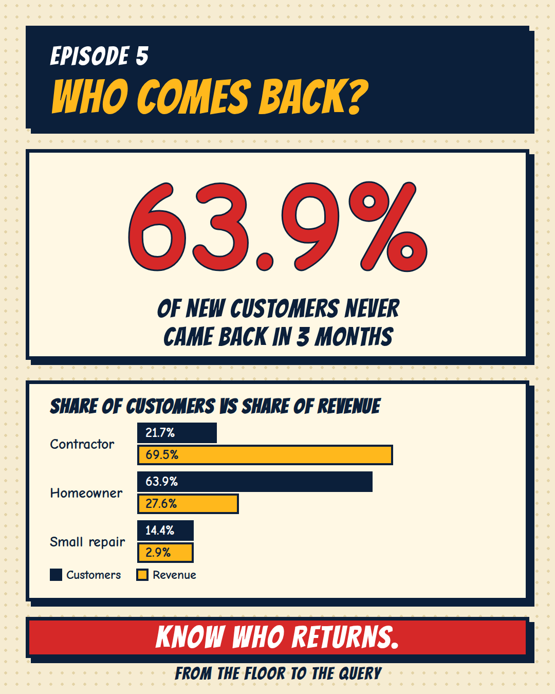

[← Back to all episodes](../README.md)

# Episode 5: Who comes back to buy again?



> All data here is synthetic, built to resemble a building-materials store. Repeat habits were set in `generate_data.py`.

## The problem
I tracked what sold at the counter. I never tracked who returned.

## The question
Of the customers who buy once, how many place another order, and who brings the revenue?

## Approach
1. Find each customer's first order month (their cohort).
2. For every later order, count how many calendar months after the first it fell (`month_n`).
3. Count distinct customers per cohort and `month_n`, divide by cohort size.
4. Split customers by type to see who the flat average hides.

## Results (dataset: 1,187 customers, 2,404 orders, ₹2,47,81,650, 1 Oct 2025 to 30 Sep 2026)
| Measure | Value |
|---|---|
| New customers who never came back by the end of the 3rd month after their first order (902 customers first buying Oct 2025 to Jun 2026) | 63.9% |
| Cohort retention, months 1 / 2 / 3 (pooled, same cohorts) | 18.5% / 18.5% / 17.8% |
| Customers with 2+ orders | 41.8% of customers, 80.3% of revenue |

| Type | Customers | Share of customers | Repeat (2+ orders) | Revenue | Share of revenue |
|---|---|---|---|---|---|
| Contractor | 257 | 21.7% | 91.1% | ₹1,72,13,370 | 69.5% |
| Homeowner | 759 | 63.9% | 20.9% | ₹68,39,800 | 27.6% |
| Small repair | 171 | 14.4% | 60.2% | ₹7,28,480 | 2.9% |

The SQL result was cross-checked with an independent pandas calculation (`crosscheck_pandas.py`): zero difference on the retention table, same headline numbers.

## Files
- `generate_data.py`: seeded generator (seed 2026)
- `data/orders.csv`, `data/customers.csv`
- `sql/cohort_retention.sql`, `sql/headline_numbers.sql`, `sql/repeat_revenue_by_type.sql`
- `run_sql.py`: loads the CSVs into DuckDB and runs the cohort query
- `crosscheck_pandas.py`: independent check
- `results/`: output CSVs

## How to run
```
pip install duckdb pandas numpy
python generate_data.py
python run_sql.py
python crosscheck_pandas.py
```

## Limits
- Synthetic data. Contractors, homeowners and small-repair buyers were given different return rates in the generator, so the split is a demo of the method, not a finding.
- "Repeat" and revenue share cover a 12-month window. Older customers had more time to return than newer ones.
- Late cohorts are too young for later months, so those cells are blank. Never read them as zero.
- Retention here is "ordered again in that month", not "ordered every month".

## Level up
- Add a `customer_type` column to the cohort query and compare the three curves.
- Retention by revenue (rupees kept), not just headcount.
- Time to second order: median days between first and second purchase.
