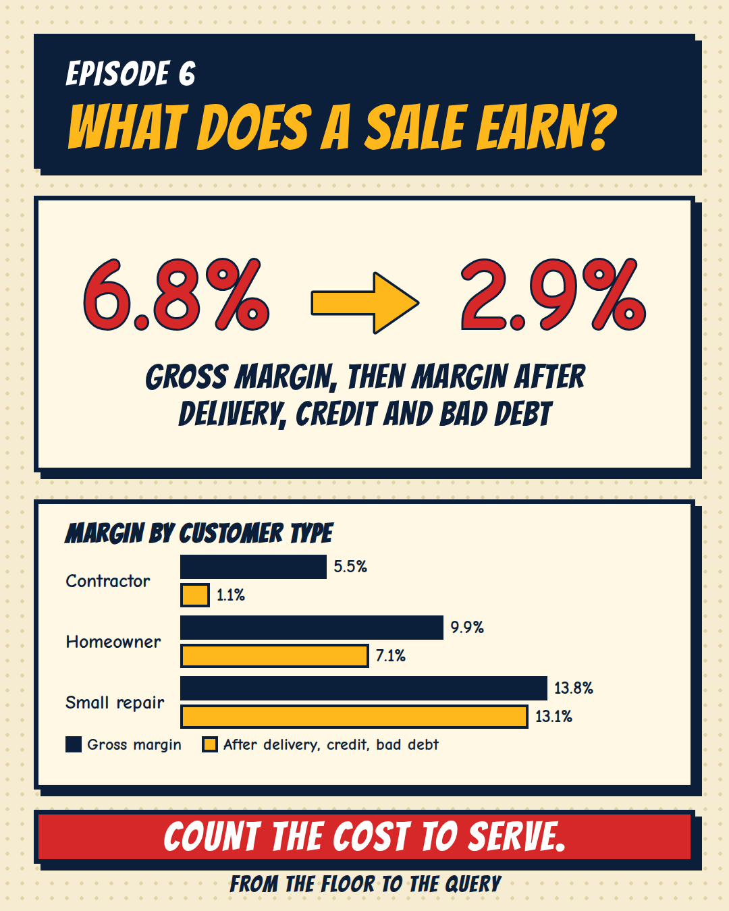

[← Back to all episodes](../README.md)

# Episode 6: What does one sale really earn?



> All data here is synthetic, built to resemble a building-materials store. Margins, delivery habits, credit terms, bad debt and every fixed cost were SET in `generate_data.py` or assumed in the model. This is a model, not a real set of books.

## The problem
Gross margin tells you what a sale earns before it leaves the shop. It does not count the truck, the days a customer holds your money, or the bills that are never paid.

## The question
After delivery, credit and bad debt, what does each customer type really earn, and does the store cover its fixed costs?

## Approach
1. Gross profit per order = order value − cost of goods.
2. Contribution per order = gross profit − delivery cost − credit cost − bad debt.
   - Credit cost = order value × 18% a year × credit days / 365 (**assumption**: the yearly cost of money tied up in credit).
   - Bad debt = the full order value of orders never paid.
3. Sum by customer type, then by store.
4. Store profit = contribution − fixed costs (rent, salaries, electricity, other).
5. Break-even sales = fixed costs / contribution margin.

## Results (dataset: 3,650 orders, 1 Oct 2025 to 30 Sep 2026)
| Store, full year | ₹ |
|---|---|
| Revenue | ₹3,82,87,880 |
| Gross profit (6.8%) | ₹26,18,019 |
| Delivery | −₹10,59,350 |
| Credit cost | −₹3,47,306 |
| Bad debt | −₹93,390 |
| **Contribution (2.9%)** | **₹11,17,973** |
| Fixed costs | −₹12,74,049 |
| **Operating profit** | **−₹1,56,076** |
| Break-even sales for the year | ₹4,36,33,108 |

| Type | Share of revenue | Share of gross profit | Share of contribution | Gross margin | After cost to serve | Contribution per order |
|---|---|---|---|---|---|---|
| Contractor | 73.0% | 59.0% | 27.9% | 5.5% | 1.1% | ₹176 |
| Homeowner | 23.8% | 34.5% | 57.7% | 9.9% | 7.1% | ₹518 |
| Small repair | 3.2% | 6.5% | 14.4% | 13.8% | 13.1% | ₹256 |

8 of 12 months made an operating loss.

The SQL result was cross-checked with the independent pandas model (`crosscheck.py`): the only differences are rounding (at most ₹0.03 on any total).

## Files
- `generate_data.py`: seeded generator (seed 2026, 6)
- `data/orders.csv`, `data/customers.csv`, `data/fixed_costs.csv`
- `python/unit_model.py`: the pandas model and its assumptions
- `sql/contribution_by_type.sql`, `sql/store_pl.sql`: independent SQL version
- `run_sql.py`: loads the CSVs into DuckDB and runs the SQL
- `crosscheck.py`: compares the SQL with the pandas model
- `results/`: output CSVs

## How to run
```
pip install duckdb pandas numpy
python generate_data.py
python python/unit_model.py
python run_sql.py
python crosscheck.py
```

## Limits
- Every cost input is an assumption set by me: delivery costs, credit days, the 18% cost of money, 0.5% bad debt, and all fixed costs. Change them and the answer changes.
- Contractors were given thin margins, heavy delivery and most of the credit in the generator. The split is a demo of the method, not a finding about any real store.
- The owner's own pay is not in the fixed costs.
- Revenue climbs through the year (₹18,81,130 in Oct to ₹43,17,210 in Sep) because customers who first buy during the year keep adding to a base of 700 existing ones. The last months are close to break-even, the first months are not.
- Delivery cost is per delivered order, not per trip. Shared trips would lower it.

## Level up
- Cost of delivery per truck trip with orders grouped by day.
- Sensitivity: how does operating profit move if the cost of money is 12% or 24%?
- Contribution per customer over the year, not per order.
