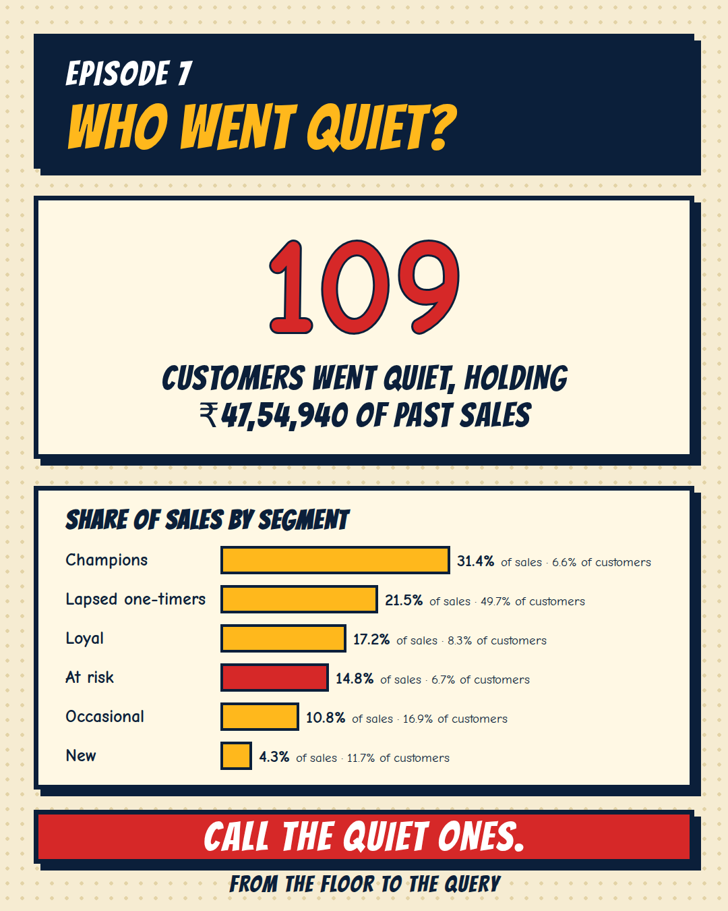

[← Back to all episodes](../README.md)

# Episode 7: Who went quiet? Customer segmentation with RFM



> All data here is synthetic, built to resemble a building-materials store. Return habits and the chance of a customer going quiet for good were SET in `generate_data.py`, per customer type.

## The problem
In Episode 5 I never tracked who returned. Knowing the share who come back is not enough: which customers do you call first?

## The question
Which customers are my best, which are slipping away, and how much money sits with the ones who went quiet?

## Approach
RFM scores every customer on three things, as of 1 Oct 2026:
- **Recency**: days since the last order. Bands: ≤30 = 5, 31 to 60 = 4, 61 to 90 = 3, 91 to 180 = 2, over 180 = 1.
- **Frequency**: number of orders. Bands: 1 = 1, 2 = 2, 3 to 4 = 3, 5 to 7 = 4, 8+ = 5.
- **Monetary**: total spend, scored in quintiles with `NTILE(5)`.

Segments (checked in this order):
| Segment | Rule |
|---|---|
| Champions | R ≥ 4 and F ≥ 4 |
| Loyal | R ≥ 3 and F ≥ 3 |
| At risk | R ≤ 2 and F ≥ 3 (3+ orders, none in 90+ days) |
| New | F = 1 and R ≥ 4 |
| Lapsed one-timers | F ≤ 2 and R ≤ 2 |
| Occasional | everyone else |

R and F use fixed bands, not `NTILE`. `NTILE` on frequency would split 925 customers who all have exactly 1 order into 5 different scores.

## Results (dataset: 1,617 customers who ordered, 3,225 orders, ₹3,21,95,300, 1 Oct 2025 to 30 Sep 2026)
| Segment | Customers | Share of customers | Revenue | Share of revenue | Avg orders | Avg spend | Avg days since last order |
|---|---|---|---|---|---|---|---|
| Champions | 106 | 6.6% | ₹1,01,01,300 | 31.4% | 6.6 | ₹95,295 | 26 |
| Lapsed one-timers | 804 | 49.7% | ₹69,31,530 | 21.5% | 1.2 | ₹8,621 | 207 |
| Loyal | 135 | 8.3% | ₹55,43,520 | 17.2% | 3.7 | ₹41,063 | 41 |
| **At risk** | **109** | **6.7%** | **₹47,54,940** | **14.8%** | **3.9** | **₹43,623** | **159** |
| Occasional | 274 | 16.9% | ₹34,80,010 | 10.8% | 1.7 | ₹12,701 | 53 |
| New | 189 | 11.7% | ₹13,84,000 | 4.3% | 1.0 | ₹7,323 | 27 |

The scoring never used customer type. Even so, 99 of the 106 Champions (93.4%) are contractors, and 66 of the 109 At risk customers (60.6%) are contractors who went quiet. Those habits were set in the generator, so this shows the method works, not that any real store looks like this.

The SQL was cross-checked with an independent pandas version (`crosscheck.py`): zero mismatches on recency, frequency, monetary, all three scores and the segment for all 1,617 customers.

## Files
- `generate_data.py`: seeded generator (seed 2026, 7)
- `data/orders.csv`, `data/customers.csv`
- `sql/rfm_segments.sql`: RFM scores and segments, one row per customer
- `sql/segment_summary.sql`: size and money by segment
- `run_sql.py`: loads the CSVs into DuckDB and runs the SQL
- `python/rfm_pandas.py`: independent pandas version, plus the segment-by-type mix and the NTILE demo
- `crosscheck.py`: compares SQL and pandas customer by customer
- `results/`: output CSVs

## How to run
```
pip install duckdb pandas numpy
python generate_data.py
python run_sql.py
python python/rfm_pandas.py
python crosscheck.py
```

## Limits
- Synthetic data. Contractors were given frequent orders and a 6% monthly chance of going quiet for good; homeowners rarely return. The split is a demo of the method, not a finding.
- The bands (90 days quiet, 3+ orders) are my choice. A real store should set them from how often its own customers buy.
- "Went quiet" is not "lost". Someone with no order in 159 days may just be between projects.
- The customer list has 1,891 names, but only 1,617 ordered in the year. RFM scores only the 1,617 who ordered. (The 274 Occasional customers in the table are a different group that happens to share that number.)
- Only 12 months of orders, so a customer's "last order" can hide a purchase before October 2025.

## Level up
- Score the segments by month to see who moves from Loyal to At risk.
- Rank At risk customers by monetary value so the biggest accounts get the first call.
- Compare the fixed bands with `NTILE` on a store whose customers order much more often.
