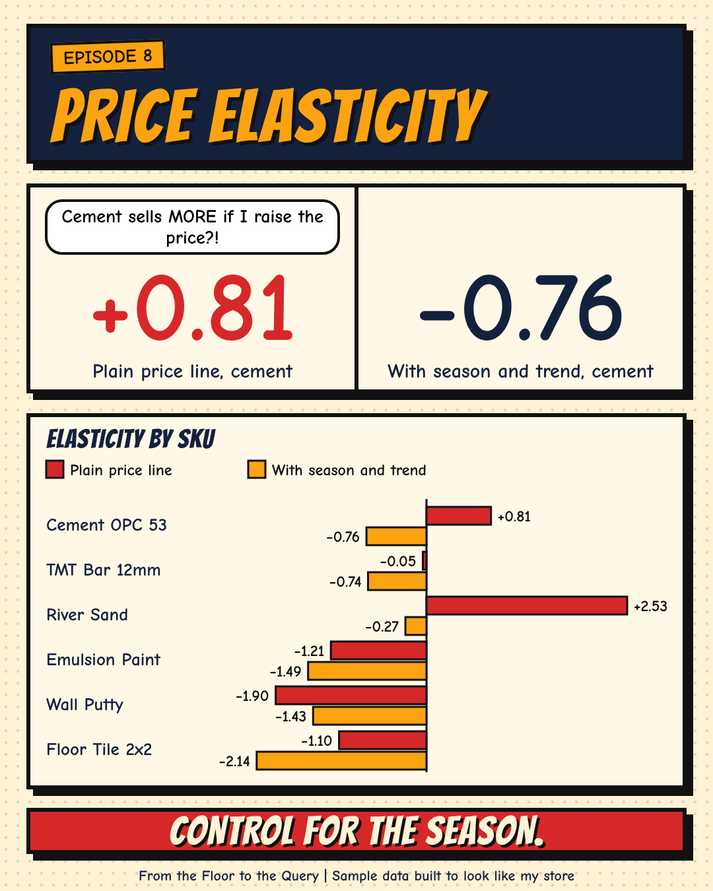

[← Back to all episodes](../README.md)

# Episode 8: Price elasticity (Python + stats)



*From the Floor to the Query. Real business problems. Real code. One analyst who's seen both sides.*

## The problem
A store changes prices all the time. The question nobody checks: when the price moves, how much do the units move? That ratio is **price elasticity** (the % change in units for a 1% change in price). If you get it wrong, you discount where it costs you and hold the price where you could have earned more.

## The question
For each of 6 SKUs, how many fewer (or more) units sell when the price goes up 1%? And does a simple price-vs-units line give the same answer as a model that knows about the season?

## The data (synthetic)
A sample dataset built to look like a building-materials store. 6 SKUs, 52 weekly rows each (weeks starting 1 Oct 2025, last week starts 23 Sep 2026), 312 rows. Each SKU's price changed 18 to 26 times in the year, in whole rupees, always above cost. Files: `data/weekly_sales.csv` (week_start, week, month, sku, price, units), `data/skus.csv` (sku, cost_price). Separate dataset from earlier episodes.

**What the generator SET (plainly):**
- The true elasticity of each SKU (`data/true_elasticity_generator.csv`): cement -0.60, TMT bar -0.90, sand -0.40, paint -1.80, putty -1.40, tile -2.10.
- A seasonal shape for each SKU and a small growth trend.
- A habit of raising prices in busy weeks and cutting them in slow weeks. This is the trap: price and units both go up in the busy season, so a plain line can read it as "higher price, more sales".
- Thin margins (cement about 3.7%, tile about 13.6%) and 4% weekly noise.

**How the data was settled (plainly):** the first run had too little price movement and too much noise (standard errors of 0.5 to 0.7 on cement), so I made prices move more often, cut the noise and kept prices inside a believable band of the usual price. A later check found 4 rows where the saved price was at or below cost, because a price floor like ₹48.24 was cut to ₹48 when saved. I fixed the generator to use whole rupees above cost and reran everything, so every number here comes from the fixed version. The seed (2026 + 8) was not searched for.

## Approach
1. **Baseline:** `ln(units) ~ ln(price)` per SKU. The slope is the elasticity (log-log model).
2. **Model:** the same regression plus calendar-month dummies and a week trend: `ln(units) ~ ln(price) + C(month) + week`. Robust (HC1) standard errors, 95% interval.
3. **What-if:** cut every price 3%, units move by 0.97^elasticity, recompute gross profit at the year's average price and the fixed cost price.
4. **Cross-check:** baseline repeated in DuckDB SQL (`regr_slope`), model repeated with plain numpy least squares.

## Results
Elasticity by SKU (the true value is known only because the generator set it):

| SKU | Price changes | Baseline | Model | 95% interval | True (set) | Interval holds true |
|---|---|---|---|---|---|---|
| Cement OPC 53 | 18 | +0.81 | -0.76 | -1.62 to +0.11 | -0.60 | yes |
| TMT Bar 12mm | 22 | -0.05 | -0.74 | -0.99 to -0.49 | -0.90 | yes |
| River Sand | 21 | +2.53 | -0.27 | -0.67 to +0.14 | -0.40 | yes |
| Emulsion Paint | 21 | -1.21 | -1.49 | -1.77 to -1.22 | -1.80 | no |
| Wall Putty | 25 | -1.90 | -1.43 | -1.72 to -1.14 | -1.40 | yes |
| Floor Tile 2x2 | 26 | -1.10 | -2.14 | -2.45 to -1.83 | -2.10 | yes |

- The baseline gets the **sign wrong** on cement (+0.81) and river sand (+2.53): "raise the price, sell more". That is the busy-season effect, not customers.
- With season and trend, every SKU has the right sign. 5 of 6 intervals hold the true value. **Emulsion Paint misses** (model -1.49, interval -1.77 to -1.22, set at -1.80), so a 95% interval is not a guarantee.
- Cement is the noisiest: model -0.76, interval -1.62 to +0.11. Do not bet on one number.

What a 3% price cut does at the model's elasticity (annual, at the year's average price):

| SKU | Margin | Extra units needed to break even | Extra units the model expects | Gross profit change |
|---|---|---|---|---|
| Cement OPC 53 | 3.7% | 408% | 2.3% | -₹2,26,638 |
| TMT Bar 12mm | 10.7% | 39% | 2.3% | -₹29,431 |
| River Sand | 11.0% | 38% | 0.8% | -₹21,124 |
| Emulsion Paint | 13.7% | 28% | 4.7% | -₹1,35,818 |
| Wall Putty | 16.4% | 22% | 4.5% | -₹72,055 |
| Floor Tile 2x2 | 13.6% | 28% | 6.7% | -₹39,071 |

- Year totals: revenue ₹1,94,96,117, gross profit ₹19,41,542.
- Cement: a 3% cut at a 3.7% margin leaves under 1 point, so break-even needs about 408% more bags (very sensitive to the exact margin). The model expects about 2.3% more. Gross profit change -₹2,26,638 on ₹2,83,805.
- All six SKUs lose gross profit on a 3% cut. That follows from thin margins and elasticities that are not extreme, both set in the generator. It is not a finding about real stores.
- Across all six, gross profit changes by -₹5,24,138 with the model, -₹5,38,478 with the baseline and -₹5,18,742 with the true values. The baseline total looks close only because its per-SKU errors cancel. Per SKU it is wrong.

## Files
- `generate_data.py`: builds the data (seeded).
- `data/`: `weekly_sales.csv`, `skus.csv`, `true_elasticity_generator.csv` (for checking only).
- `python/elasticity.py`: baseline, model, what-if.
- `crosscheck.py`: DuckDB SQL and numpy checks.
- `results/`: `elasticity_by_sku.csv`, `elasticity_output.txt`, `crosscheck_output.txt`.
- `cover.png`: the post image.

## How to run
```
pip install pandas numpy statsmodels duckdb
python generate_data.py
python python/elasticity.py
python crosscheck.py
```
Run from inside the `episode-8` folder. Cross-check result: the baseline (Python vs SQL) and the model (statsmodels vs numpy) agree to within 0.00005. The gap is only the 4-decimal rounding in the results file.

## Limits
- Constant elasticity: one number per SKU, used for a small 3% move. Do not stretch it to a 30% change.
- One year of weekly data. Month dummies and price are partly tangled, which is why intervals are wide (cement most of all).
- The month controls match how the generator built the season. A real store would not know the true shape of its season, and omitted causes (a competitor, a supplier shortage, a festival) would bias the number again.
- A pattern in observed prices is not proof of cause. Here we know why prices moved, because the generator did it. In real data you would need to find that out.
- Gross profit only. No stock holding cost, no substitution between SKUs, no customers who leave for good.

## Level up
Use only weeks where a price change was forced from outside (a supplier cost rise) and compare with the all-weeks estimate. Or pool the SKUs in one model with SKU-specific slopes and compare the intervals.
