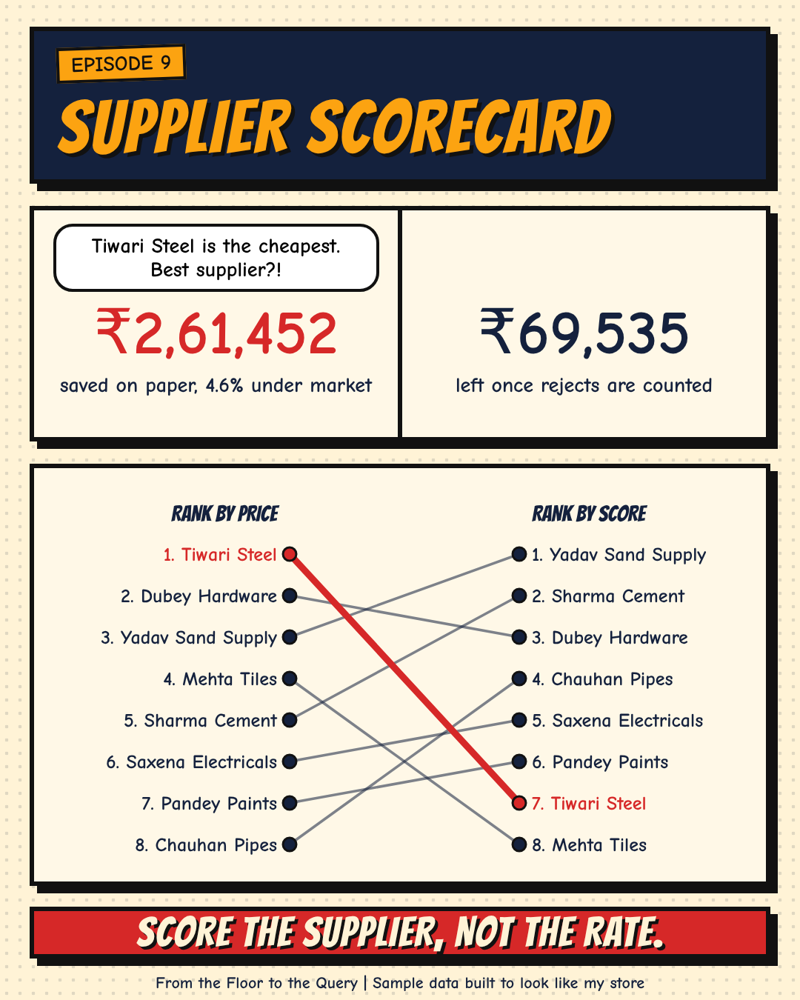

[← Back to all episodes](../README.md)

# Episode 9: Supplier performance scorecard (SQL + DAX)



*From the Floor to the Query. Real business problems. Real code. One analyst who's seen both sides.*

## The problem
Most shops pick a supplier on rate. The rate is the only number on the quotation. But a supplier also delivers late, delivers short, sends goods that get rejected and invoices a little above the quote. None of that shows on the rate. A scorecard puts those columns next to the price.

## The question
For 8 suppliers and a year of purchase orders: who delivers on time, in full and in good condition, who is cheap only on paper, and does the ranking change when you score the supplier instead of the rate?

## The data (synthetic)
A sample dataset built to look like a building-materials store. 700 purchase orders from 8 suppliers, 1 Oct 2025 to 30 Sep 2026 (70 to 110 orders each), seeded (2026 + 9). File: `data/purchase_orders.csv` (po_id, supplier, category, order_date, promised_date, received_date, qty_ordered, qty_received, qty_rejected, market_rate, quoted_rate, invoiced_rate). Separate dataset from Episode 2 (which looked at lead time drift, not scoring).

**What the generator SET (plainly):**
- Each supplier's on-time habit, average delay, fill rate, reject rate, price level against the market and invoice creep (`data/supplier_settings_generator.csv`, for checking only).
- The trap: the cheapest supplier on rate (Tiwari Steel, 4.6% under market) is also the least reliable on time and the second worst on rejects.
- `market_rate` is a benchmark rate for each order that I made up. A real store would need a price list or a quote from a second supplier for this column.

No tuning after the first run. The seed was not searched for. Every row was audited before analysis (no duplicates, no blanks, no received quantity above ordered, no rejects above received, no received date before the order date).

## Approach
1. **Metrics per supplier** (SQL, DuckDB): on-time % (received on or before the promised date), average days late (late orders only), fill % (received / ordered), reject % (rejected / received), price index (rupees paid / rupees at market for the quantity received).
2. **Usable price index:** rupees paid / market value of the units that were *not* rejected. This is what you pay per unit you can sell. **Assumption: rejected units are paid for and not credited.**
3. **Points, 0 to 100:** on-time % as is; fill % as is; quality = 100 - 10 x reject %; price = 100 - 1,000 x (price index - 0.95), kept between 0 and 100 (every 1% over 95% of market costs 10 points).
4. **Score:** weights are an **assumption**: on time 35, fill 25, quality 25, price 15.
5. **Sensitivity:** the same points with price-first weights (on time 15, fill 10, quality 25, price 50).
6. **Ranks:** `RANK() OVER` on price index, score and price-first score.
7. **Cross-check:** the whole scorecard rebuilt in plain pandas; compared with the SQL output.

## Results
Sorted by score. Price index 1.000 = market. Ranks: price (1 = cheapest), score (1 = best), and price-first (the sensitivity run).

| Supplier | POs | On time | Avg days late | Fill | Reject | Price index | Usable price index | Score | Price rank | Score rank | Price-first rank |
|---|---|---|---|---|---|---|---|---|---|---|---|
| Yadav Sand Supply | 90 | 87.8% | 1.8 | 97.6% | 1.5% | 0.984 | 1.000 | 86.1 | 3 | 1 | 3 |
| Sharma Cement | 110 | 92.7% | 1.6 | 99.6% | 0.8% | 1.012 | 1.020 | 86.1 | 5 | 2 | 4 |
| Dubey Hardware | 95 | 71.6% | 2.7 | 95.2% | 1.2% | 0.974 | 0.985 | 82.3 | 2 | 3 | 2 |
| Chauhan Pipes | 75 | 94.7% | 1.3 | 99.5% | 0.4% | 1.061 | 1.066 | 81.9 | 8 | 4 | 8 |
| Saxena Electricals | 85 | 87.1% | 2.0 | 97.2% | 1.5% | 1.031 | 1.046 | 79.0 | 6 | 5 | 6 |
| Pandey Paints | 70 | 82.9% | 1.3 | 98.3% | 0.6% | 1.043 | 1.049 | 78.1 | 7 | 6 | 7 |
| Tiwari Steel | 95 | 61.1% | 3.7 | 93.0% | 3.4% | 0.954 | 0.987 | 75.6 | 1 | 7 | 1 |
| Mehta Tiles | 80 | 72.5% | 3.3 | 95.5% | 4.3% | 0.998 | 1.043 | 71.2 | 4 | 8 | 5 |

- **Tiwari Steel is #1 on price and #7 on score.** On time 61.1% (37 of 95 orders late, 3.7 days on average), fill 93.0%, rejects 3.4%.
- **The cheap rate shrinks.** On ₹53,83,430 of orders, 4.6% under market is worth ₹2,61,452 on paper. Per usable unit it is 1.3% under market, worth ₹69,535. The rejected units alone were ₹1,82,998 of what was paid.
- **Per usable unit it is no longer the cheapest.** Dubey Hardware is 0.985, Tiwari Steel 0.987.
- **The ranking depends on the weights.** With price at 50 points, Tiwari Steel is #1 again and Chauhan Pipes (94.7% on time, 6.1% over market) falls to #8. The weights are a business decision, so show both.
- **Yadav Sand Supply and Sharma Cement are a tie** (86.1 and 86.1 after rounding; 86.13 against 86.08 unrounded). Do not read #1 against #2 as a real gap.
- **Small samples:** with about 95 orders, an on-time rate has a margin of roughly +/- 10 points. Tiwari Steel (61.1%) is clearly the weakest. Dubey Hardware (71.6%) and Mehta Tiles (72.5%) are not clearly different from each other.

## DAX (NOT RUN)
`dax/scorecard_measures.dax` has the same measures in DAX. **It was not run: there is no Power BI here.** It was written by logic only. The expected values per supplier are at the top of the file; check them in Power BI before you trust the measures.

## Files
- `generate_data.py`: builds the data (seeded).
- `data/`: `purchase_orders.csv`, `supplier_settings_generator.csv` (for checking only).
- `sql/scorecard.sql`: the scorecard (DuckDB).
- `run_sql.py`: runs the SQL and saves `results/scorecard.csv`.
- `crosscheck.py`: independent pandas rebuild and comparison.
- `dax/scorecard_measures.dax`: DAX measures (not run).
- `results/`: `scorecard.csv`, `crosscheck_output.txt`.
- `cover.png`: the post image.

## How to run
```
pip install pandas numpy duckdb
python generate_data.py
python run_sql.py
python crosscheck.py
```
Run from inside the `episode-9` folder. Cross-check result: all metrics, scores and the three ranks match. The rounded SQL values sit within half a rounding step of the unrounded pandas values. The one visible gap type is a tie at the rounding digit (SQL rounds 1.25 up to 1.3, Python's `round` gives 1.2).

## Limits
- The weights, the points formulas and the "rejected units are paid for" assumption are mine. Change them and the ranks move.
- `market_rate` is a made-up benchmark. Price indexes are only as good as that column.
- Late delivery is scored as a rate. It has no rupee cost here (stock-outs, idle labour, lost sales). A real scorecard should price it.
- 8 suppliers in 8 different categories. In real life you compare suppliers of the same item first.
- One year, 70 to 110 orders per supplier. Rates carry a margin of several points.

## Level up
Put a rupee cost on each day late (for example the margin lost on a stock-out) and add it to the usable price. Or compare the last 90 days with the full year to see who is getting worse (that is Episode 2's drift question, applied to a scorecard).
